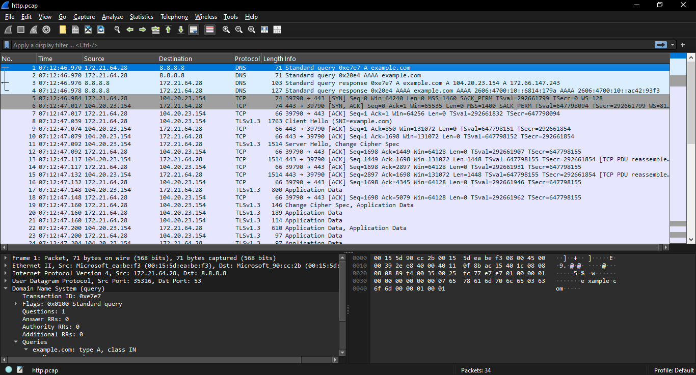
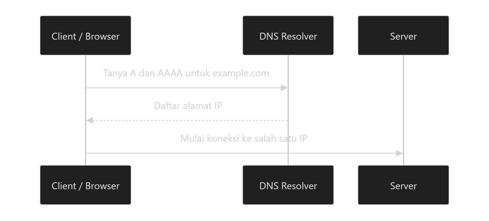
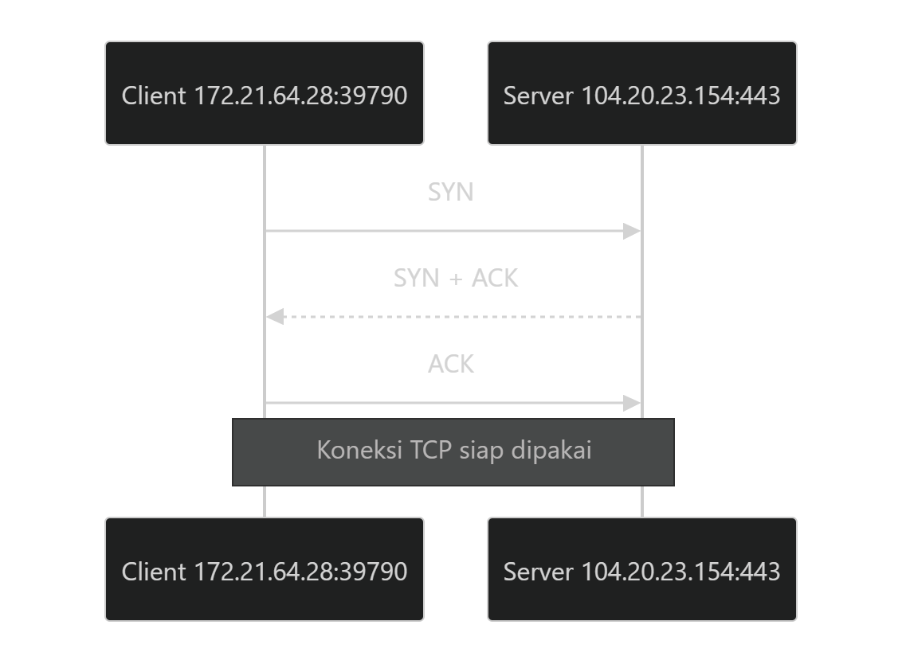
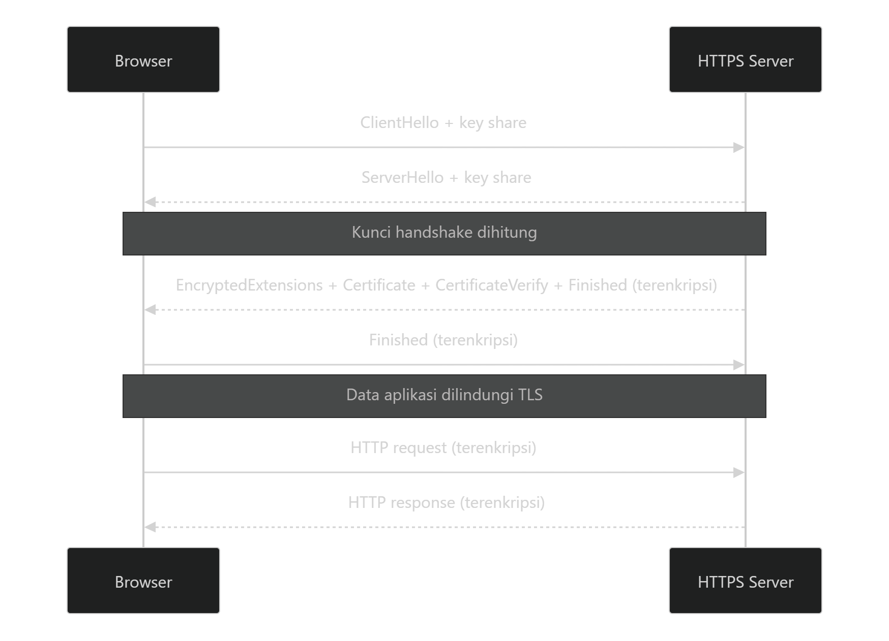

Ketika kita mengetik `https://example.com` di browser, halaman biasanya muncul dalam hitungan detik. Di balik proses sederhana itu, komputer perlu mencari alamat server, membuka koneksi, menyepakati enkripsi, mengirim permintaan, dan menerima data. Setiap tahap melibatkan protokol dengan tugas yang berbeda.




Artikel ini membedah proses tersebut dari sudut pandang jaringan (*low level*), tanpa harus masuk terlalu jauh ke rumus kriptografi atau detail implementasi kernel. Sebagai rujukan, saya sudah meyiapkan file **`https.pcap`** yang berisi tangkapan paket https. Untuk yang ingin mencobanya bisa download [disini](https://limewire.com/d/F8opX#Ti6X0uT5zL) lalu buka dengan **Wireshark**.

## 1. HTTP sebenarnya mengurus apa?

**HTTP (Hypertext Transfer Protocol)** adalah protokol pada lapisan aplikasi yang mendefinisikan cara klien meminta sumber daya dan cara server membalasnya. Browser bertindak sebagai *client*, sedangkan server web menyediakan halaman, gambar, data API, dan sumber daya lain.

Gambaran sederhananya:

```text
Browser (client)                                Web server
     |                                              |
     |  GET /artikel HTTP/1.1                       |
     |  Host: example.com                           |
     |--------------------------------------------->|
     |                                              |
     |  HTTP/1.1 200 OK                             |
     |  Content-Type: text/html                     |
     |  <html>...</html>                            |
     |<---------------------------------------------|
```

Contoh di atas memperlihatkan **format HTTP/1.1 secara konseptual**, bukan teks yang berhasil dibaca dari file `https.pcap`.

Ada tiga komponen utama:

- **Method**, seperti `GET` untuk meminta data dan `POST` untuk mengirim data untuk diproses.
- **Header**, yaitu metadata, misalnya `Host`, `Content-Type`, atau `Cookie`.
- **Body**, yakni isi pesan jika ada, seperti HTML atau JSON.

Server juga mengirim **status code** seperti `200` (berhasil), `301` (pengalihan), `404` (tidak ditemukan), atau `500` (kesalahan server).

HTTP bersifat *stateless*: setiap permintaan mempunyai makna tersendiri. Namun aplikasi tetap dapat mempertahankan pengalaman login atau keranjang belanja memakai cookie, sesi, atau token.

## 2. HTTP dan HTTPS

Perbedaan paling penting bukan pada tujuan komunikasinya, melainkan pada **perlindungan ketika pesan dikirim**.

```text
HTTP/1.1 tanpa TLS                    HTTPS (HTTP/1.1 atau HTTP/2)
┌──────────────────────┐               ┌──────────────────────┐
│ HTTP request/response│               │ HTTP request/response│
├──────────────────────┤               ├──────────────────────┤
│ TCP                  │               │ TLS (enkripsi)       │
├──────────────────────┤               ├──────────────────────┤
│ IP                   │               │ TCP                  │
├──────────────────────┤               ├──────────────────────┤
│ Ethernet / Wi-Fi     │               │ IP                   │
└──────────────────────┘               ├──────────────────────┤
                                       │ Ethernet / Wi-Fi     │
                                       └──────────────────────┘
```

Pada HTTP biasa, pihak yang mampu memantau lalu lintas jaringan berpotensi membaca atau mengubah isi komunikasi. Pada **HTTPS**, HTTP berjalan di dalam koneksi yang dilindungi **TLS (Transport Layer Security)**. TLS menyediakan kerahasiaan, pemeriksaan integritas, dan autentikasi server berbasis sertifikat, selama validasi sertifikat berjalan dengan benar.

Port yang lazim digunakan ialah **80 untuk HTTP** dan **443 untuk HTTPS**, tetapi nomor port bukan jaminan jenis protokol. Sebagai contoh, HTTPS juga dapat dijalankan pada port lain.

> **Pengecualian penting:** Diagram di atas menggambarkan HTTPS berbasis TCP. **HTTP/3 menggunakan QUIC di atas UDP**, dengan TLS 1.3 terintegrasi ke QUIC, sehingga tidak melalui *TCP three-way handshake*.

## 3. Sebelum HTTP dimulai, browser mencari alamat IP melalui DNS

Nama domain nyaman bagi manusia, tetapi jaringan IP membutuhkan alamat tujuan. Karena itu, klien biasanya perlu melakukan **DNS lookup** terlebih dahulu, kecuali jawabannya sudah tersedia di cache atau menggunakan mekanisme resolusi lain.

DNS dapat meminta beberapa jenis record. Dua yang umum adalah:

- **A record** untuk alamat IPv4.
- **AAAA record** untuk alamat IPv6.

Alurnya dapat digambarkan seperti ini:



### Apa yang terlihat pada `https.pcap`?

Paket **1–4** memperlihatkan resolusi DNS:

| Paket | Arah komunikasi | Pengamatan |
|---|---|---|
| 1 | `172.21.64.28:35316 → 8.8.8.8:53` | Pertanyaan DNS record **A** untuk `example.com` |
| 2 | `172.21.64.28:35316 → 8.8.8.8:53` | Pertanyaan DNS record **AAAA** untuk `example.com` |
| 3 | `8.8.8.8:53 → 172.21.64.28:35316` | Jawaban A: `104.20.23.154` dan `172.66.147.243` |
| 4 | `8.8.8.8:53 → 172.21.64.28:35316` | Jawaban AAAA: `2606:4700:10::6814:179a` dan `2606:4700:10::ac42:93f3` |

Alamat `172.21.64.28` adalah alamat IPv4 privat di sisi klien dalam rekaman ini; `8.8.8.8` bertindak sebagai resolver DNS. Tangkapan tersebut menggunakan **DNS biasa melalui UDP port 53**, sehingga nama domain yang dicari terlihat jelas di paket.

Kita juga bisa melihat bahwa komputer menerima lebih dari satu alamat IP. Ini normal: suatu domain dapat mengarah ke beberapa server atau *edge node* untuk distribusi beban dan ketersediaan layanan. Dalam rekaman ini, koneksi berikutnya memilih `104.20.23.154` melalui IPv4.

## 4. TCP: membangun jalur komunikasi yang andal

Setelah alamat tujuan diketahui, klien perlu membentuk koneksi. Untuk HTTPS berbasis HTTP/1.1 atau HTTP/2, pengangkutnya biasanya **TCP (Transmission Control Protocol)**.

TCP membantu data sampai **berurutan** dan dapat mendeteksi bagian yang hilang agar dikirim ulang. Sebelum bertukar data aplikasi, kedua pihak melakukan *three-way handshake*:



Ketiga pesan ini bukan sekadar formalitas. Keduanya menyinkronkan **sequence number**, yaitu penanda posisi byte dalam aliran TCP, sehingga penerima tahu data mana yang sudah diterima. Pesan `ACK` mengonfirmasi penerimaan data; **TCP window** membantu mengatur berapa banyak data yang dapat dikirim sebelum perlu menunggu konfirmasi berikutnya.

### Bukti di capture

| Paket | Flag TCP | Arah | Makna |
|---|---|---|---|
| **5** | `SYN` | Klien `39790` → Server `443` | Meminta koneksi |
| **6** | `SYN, ACK` | Server `443` → Klien `39790` | Menerima dan mengonfirmasi |
| **7** | `ACK` | Klien → Server | Menyelesaikan handshake |

Perhatikan angka `39790`. Ini adalah **ephemeral port** di sisi klien: nomor port sementara untuk membedakan koneksi tersebut dari koneksi lain. Di sisi server, port `443` adalah port layanan HTTPS.

Koneksi umumnya diidentifikasi dengan kombinasi **IP sumber, port sumber, IP tujuan, port tujuan, dan protokol transport**. Kombinasi ini memungkinkan beberapa komunikasi berlangsung bersamaan tanpa tertukar.

## 5. TLS: menyepakati keamanan sebelum mengirim HTTP

TCP yang sukses belum berarti HTTP boleh langsung dikirim sebagai HTTPS. Klien dan server masih perlu menjalankan **TLS handshake**. Proses ini, secara umum, mencakup:

1. **ClientHello**: klien menawarkan versi TLS, algoritma kriptografi yang didukung, serta informasi lain untuk negosiasi.
2. **ServerHello**: server memilih parameter yang cocok dan mengirim kontribusinya untuk pembentukan kunci.
3. **Autentikasi server**: server membuktikan identitasnya melalui sertifikat dan tanda tangan kriptografis; klien memverifikasi sertifikat tersebut.
4. **Pembentukan kunci sesi**: kedua pihak menghasilkan kunci enkripsi untuk melindungi data berikutnya.
5. **Application Data**: pesan HTTP mulai dikirim sebagai data terenkripsi.

Diagram berikut adalah penyederhanaan *full handshake* TLS 1.3:



**Apa fungsi sertifikat?** Sertifikat membantu klien memastikan bahwa kunci publik yang diterima benar-benar terkait dengan identitas domain yang dituju, melalui rantai kepercayaan otoritas sertifikat (*Certificate Authority*). Enkripsi saja tidak cukup apabila klien tidak dapat memastikan siapa pihak di ujung koneksi.

### Apa yang dapat dilihat di `https.pcap`?

- **Paket 8** berisi **TLS ClientHello** dari klien; payload TCP yang tercatat berukuran **1.697 byte**.
- **Paket 11** diawali **TLS ServerHello**, yang menunjukkan server mulai memberikan respons negosiasi. Data handshake dari server berlanjut pada paket sesudahnya.
- **Paket 19 dan seterusnya** menunjukkan record TLS yang terkait dengan penyelesaian negosiasi dan pertukaran data terenkripsi. Terlihat pula record bertipe **Application Data** (`0x17`).

Dalam rekaman ini ServerHello memilih *cipher suite* bernilai `0x1302`, yaitu **TLS_AES_256_GCM_SHA384**, yang digunakan pada TLS 1.3. Nama suite tersebut memberitahu jenis enkripsi simetris dan fungsi hash yang digunakan, bukan berarti sertifikat atau data HTTP bisa dibaca begitu saja.

**Penting:** Pada TLS 1.3, beberapa pesan handshake setelah `ServerHello` juga sudah terenkripsi. Karena itu, melihat record `Application Data` tidak selalu berarti isinya pasti sebuah HTTP request atau response. Tanpa *TLS session keys*, kita tidak dapat memastikan teks HTTP, path, header, maupun kode status dari rekaman ini.

## 6. Dari HTTP menjadi byte, segmen, paket, dan frame

Aplikasi bekerja dengan permintaan seperti `GET /`, tetapi kartu jaringan tidak mengirim kata “GET” sebagai objek tersendiri. Data diturunkan ke beberapa lapisan yang masing-masing menambahkan informasi kendali. Proses ini disebut **encapsulation**.

```text
            Data di sisi pengirim

┌────────────────────────────────────────────┐
│ HTTP: method, header, body                 │
└────────────────────────────────────────────┘
                      ↓
┌────────────────────────────────────────────┐
│ TLS: mengenkripsi dan mengautentikasi data │
└────────────────────────────────────────────┘
                      ↓
┌────────────────────────────────────────────┐
│ TCP: port, sequence number, ACK, checksum  │
└────────────────────────────────────────────┘
                      ↓
┌────────────────────────────────────────────┐
│ IP: alamat sumber dan tujuan, TTL, dll.    │
└────────────────────────────────────────────┘
                      ↓
┌─────────────────────────────────────────────┐
│ Ethernet/Wi-Fi: pengiriman di jaringan lokal│
└─────────────────────────────────────────────┘
                      ↓
              Bit melalui media fisik
```

Di sisi penerima, urutannya dibalik (*decapsulation*). TCP menyusun ulang aliran byte jika diperlukan; TLS memverifikasi dan mendekripsi data; barulah implementasi HTTP memproses pesan aplikasi.

Satu hal yang sering membingungkan: **satu HTTP request tidak harus sama dengan satu paket TCP**. Permintaan bisa terbagi ke beberapa segmen, dan satu segmen dapat membawa bagian dari beberapa pesan aplikasi. Batas segmen TCP tidak sama dengan batas pesan HTTP atau batas record TLS.

Kondisi itu tampak pada capture: pesan TLS dari server dapat terbagi ke beberapa segmen TCP, misalnya payload **1.448 byte** pada paket 11, 13, 15, sebelum segmen berikutnya. Ukuran segmen dipengaruhi oleh *maximum segment size* (MSS), pengaturan koneksi, dan kondisi jaringan.

## 7. Melihat perjalanan satu koneksi secara utuh

Jika disusun dari paket-paket yang ada, urutan utama pada `https.pcap` tampak seperti berikut:

```text
Klien: 172.21.64.28          DNS: 8.8.8.8         Server: 104.20.23.154
       |                           |                          |
 [1]   |-- DNS A example.com ----->|                          |
 [2]   |-- DNS AAAA example.com -->|                          |
 [3-4] |<-- Jawaban IP ------------|                          |
       |                           |                          |
 [5]   |------------------------- TCP SYN ------------------->|
 [6]   |<------------------------ SYN + ACK ------------------|
 [7]   |------------------------- TCP ACK ------------------->|
       |                           |                          |
 [8]   |----------------------- TLS ClientHello ------------->|
 [11+] |<---------------------- TLS ServerHello + ... --------|
       |                           |                          |
 [19+] |<============== TLS terenkripsi =====================>|
       |                           |                          |
 [31+] |-------------------- Penutupan koneksi -------------->|
       |<------------------------ FIN / ACK ------------------|
```

Tangkapan berisi **34 paket** secara total. Paket **31–34** memperlihatkan penutupan koneksi TCP, termasuk flag `FIN` dan `ACK`. Sebuah koneksi dapat berakhir setelah transaksi selesai, karena batas waktu, atau karena aplikasi memutuskan untuk menutupnya. Dari capture ini saja, kita tidak bisa memastikan alasan aplikasi menutup koneksi.

Urutan tersebut merupakan satu contoh spesifik, **bukan aturan bahwa setiap akses website selalu menghasilkan susunan paket yang sama**. DNS mungkin berasal dari cache, TCP dapat digunakan kembali, dan HTTP/3 menggunakan transport yang berbeda.

## 8. Apa yang bisa dan tidak bisa dibaca oleh Wireshark?

Bagi orang yang mempelajari *networking* atau keamanan web, perbedaan antara informasi yang **terlihat di jaringan** dan informasi yang **terlindungi TLS** sangat penting.

| Informasi | Dalam tangkapan ini | Mengapa? |
|---|---|---|
| Domain pada permintaan DNS | **Terlihat** | DNS UDP/53 tanpa enkripsi |
| IP server dan port | **Terlihat** | Diperlukan untuk pengiriman TCP/IP |
| TCP SYN, ACK, FIN | **Terlihat** | Header TCP tidak disembunyikan TLS |
| TLS ClientHello dan ServerHello | **Sebagian terlihat** | Bagian awal negosiasi TLS terbuka |
| HTTP method, URL path, cookie | **Tidak terlihat** | Konten aplikasi terenkripsi TLS |
| Body respons HTML atau JSON | **Tidak terlihat** | Konten aplikasi terenkripsi TLS |
| Status HTTP, misalnya `200` atau `404` | **Tidak terlihat** | Termasuk informasi di dalam HTTP terenkripsi |

HTTPS **tidak menyembunyikan semuanya**. Alamat IP tujuan dan pola lalu lintas (misalnya waktu serta ukuran paket) tetap dapat diamati di banyak kondisi. Nama domain juga bisa bocor lewat DNS tanpa enkripsi atau informasi *Server Name Indication* (SNI) ketika ECH tidak digunakan. Sebaliknya, DNS terenkripsi dan *Encrypted ClientHello* (ECH) dapat mengurangi sebagian paparan informasi tersebut, bergantung pada dukungan dan konfigurasi koneksi.

### Memeriksa sendiri di Wireshark

Buka `https.pcap` di Wireshark lalu gunakan beberapa **display filter** berikut:

```text
dns
```

Untuk melihat permintaan dan jawaban DNS (paket awal).

```text
tcp.port == 443
```

Untuk menampilkan koneksi HTTPS berbasis TCP.

```text
tcp.flags.syn == 1
```

Untuk menemukan paket pembentukan koneksi, termasuk SYN dan SYN-ACK.

```text
tls
```

Untuk fokus pada pesan yang dikenali Wireshark sebagai TLS. Jika Wireshark tidak langsung mengidentifikasi semua pesan, gunakan **Follow → TCP Stream** untuk mengamati aliran byte dan periksa apakah dekode protokol sudah sesuai.

> Agar dapat melihat konten HTTP pada tangkapan HTTPS milik sendiri, penganalisis memerlukan **kunci sesi TLS yang sesuai** (misalnya berkas key log yang dikumpulkan secara sah saat koneksi dibuat). File `https.pcap` yang diberikan tidak menyertakan kunci tersebut.

## 9. Lalu bagaimana dengan HTTP/2 dan HTTP/3?

Sampai di sini kita sudah mengikuti satu koneksi TCP + TLS. Namun HTTP memiliki beberapa versi dengan cara pengemasan pesan berbeda:

| Aspek | HTTP/1.1 | HTTP/2 | HTTP/3 |
|---|---|---|---|
| Format pesan | Teks untuk *start-line* dan header | Frame biner | Frame biner di atas QUIC |
| Mengirim banyak permintaan | Umumnya perlu antrean/koneksi tambahan | *Multiplexing* dalam satu TCP | *Multiplexing* dalam QUIC |
| Transport umum | TCP | TCP | QUIC di atas UDP |
| Keamanan saat HTTPS | TLS di atas TCP | TLS di atas TCP | TLS 1.3 terintegrasi QUIC |

HTTP/2 mengizinkan beberapa *stream* HTTP menggunakan satu koneksi TCP. HTTP/3 menggunakan QUIC untuk mengurangi dampak hilangnya paket pada stream lain dibandingkan TCP, meskipun tetap dipengaruhi kondisi jaringan.

**Versi HTTP yang dipakai oleh transaksi pada capture tidak dapat dipastikan hanya dari record TLS terenkripsi yang tersedia.** HTTPS bisa membawa HTTP/1.1 ataupun HTTP/2; negosiasi protokol lazim dilakukan melalui **ALPN**. Jangan menyimpulkan versi HTTP hanya karena portnya `443`.

## 10. Mengapa memahami lapisan ini penting untuk keamanan web?

Banyak persoalan keamanan menjadi lebih mudah dipahami ketika kita tahu letak masalahnya:

- **DNS** membantu menjelaskan mengapa suatu domain diarahkan ke IP tertentu dan bagaimana kebocoran kueri domain dapat terjadi.
- **TCP** membantu menjelaskan koneksi yang gagal, *timeout*, *retransmission*, serta mengapa satu pesan aplikasi dapat terpecah menjadi beberapa segmen.
- **TLS** membantu membedakan perlindungan selama pengiriman dari keamanan aplikasi. HTTPS tidak otomatis mencegah SQL injection, XSS, atau kesalahan autentikasi.
- **HTTP** membantu membaca method, header, cookie, cache, status code, dan perilaku server yang menjadi pusat pengujian keamanan web.

Dengan sudut pandang ini, kita tidak hanya tahu bahwa browser “mengakses website”, tetapi memahami **di lapisan mana suatu perilaku terjadi** dan **bukti apa yang benar-benar tersedia dari rekaman jaringan**.

## Penutup

Sebuah akses HTTPS adalah rangkaian kerja sama beberapa protokol. DNS menerjemahkan nama domain ke alamat; TCP membangun aliran data yang andal; TLS melindungi pertukaran informasi; HTTP menentukan apa yang diminta dan bagaimana server menjawabnya. Setelah itu, IP dan teknologi jaringan lokal bertugas mengantarkan paket-paket ke tujuan.

File `https.pcap` memberi contoh yang konkret: **DNS → TCP three-way handshake → TLS handshake → data terenkripsi → penutupan koneksi**. Justru karena isi HTTP tidak terlihat, tangkapan ini juga mengajarkan batas penting analisis paket: **jangan menyamakan apa yang bisa diamati dengan semua yang benar-benar terjadi di dalam koneksi**.

## Referensi lanjutan

- [RFC 9110 — HTTP Semantics](https://www.rfc-editor.org/rfc/rfc9110.html)
- [RFC 9112 — HTTP/1.1](https://www.rfc-editor.org/rfc/rfc9112.html)
- [RFC 8446 — TLS 1.3](https://www.rfc-editor.org/rfc/rfc8446.html)
- [RFC 9113 — HTTP/2](https://www.rfc-editor.org/rfc/rfc9113.html)
- [RFC 9114 — HTTP/3](https://www.rfc-editor.org/rfc/rfc9114.html)
- [RFC 9000 — QUIC](https://www.rfc-editor.org/rfc/rfc9000.html)
