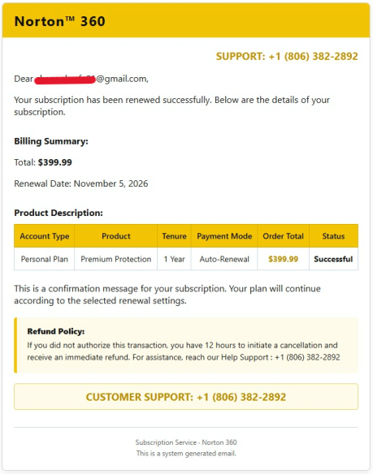

Malam-malam buka inbox Gmail, tiba-tiba ada satu email masuk dengan subjek yang agak aneh: `"Fwd: PRINT VIA Jules Auguste Breton ER 2026-11-05"`. Pengirimnya bukan dari domain korporat resmi, melainkan akun `@gmail.com` biasa, dan di dalamnya cuma ada satu lampiran file PDF.

Begitu file PDF tersebut dibuka, isinya langsung menodong dengan klaim bahwa langganan **Norton 360** untuk akun `<REDACTED>@gmail.com` telah berhasil diperpanjang secara otomatis (*Auto-Renewal*) pada tanggal 5 November 2026. Nominal yang tertera di tabel *Billing Summary* nggak tanggung-tanggung: **$399.99** (sekitar Rp6,3 jutaan) untuk paket *Personal Plan - Premium Protection* selama 1 tahun, lengkap dengan status **Successful**. Padahal, mendaftarkan akun Norton saja tidak pernah, apalagi berlangganan dan menyimpan saldo sebesar itu.

Di bagian bawah surat tagihan itu, tertulis kebijakan pengembalian dana (*Refund Policy*) yang cukup mencolok:

> *"If you did not authorize this transaction, you have 12 hours to initiate a cancellation and receive an immediate refund. For assistance, reach our Help Support: +1 (806) 382-2892"*

Bagi pengguna awam yang kebetulan punya kartu kredit atau saldo di akun pembayaran digital, melihat klaim potongan uang enam juta rupiah jelas bikin panik. Tapi kalau kita bedah dari kacamata keamanan siber, tidak ada satu sen pun uang yang terpotong dan tidak ada akun yang diretas. Ini adalah anatomi klasik dari serangan **Callback Phishing**.

## Apa Itu Callback Phishing (TOAD)?

Kalau *phishing* tradisional mengandalkan tautan (*link*) palsu di dalam email untuk mencuri *username* dan *password* korban, **Callback Phishing**—atau yang di kalangan *threat intelligence* dikenal sebagai **TOAD** (*Telephone-Oriented Attack Delivery*)—mengubah vektor serangannya ke jalur suara.

Penipu sengaja tidak menaruh tautan *login* palsu atau *malware* di dalam email. Mereka justru memancing korban agar mengambil ponsel dan **menelepon sendiri** nomor *Customer Support* palsu yang sudah disiapkan (`+1 (806) 382-2892` pada kasus dokumen di atas). Begitu korban menelepon, kendali penuh atas alur percakapan langsung berpindah ke tangan operator penipu di *scam call center*.

Kenapa metode ini makin sering dipakai? Karena jauh lebih mudah memanipulasi orang yang sedang panik lewat obrolan telepon langsung daripada berharap mereka tertipu halaman *login* tiruan yang sekarang sering langsung diblokir oleh fitur *Safe Browsing* di peramban modern.

## Analisis Teknis: Bagaimana Email Ini Mengelabui Filter Spam?

Mungkin muncul pertanyaan sederhana: *kok bisa email penipuan dari akun Gmail gratisan yang mencatut nama Norton lolos masuk ke Inbox utama tanpa dicegat filter spam Google?*

Jika kita perhatikan struktur email dan lampiran PDF `"Fwd: PRINT VIA Jules Auguste Breton ER 2026-11-05.pdf"`, ada beberapa teknik *evasion* (penghindaran deteksi) yang sengaja dirancang oleh pelaku:

### 1. Menggunakan Akun Gmail Asli (Melewati Validasi SPF, DKIM, dan DMARC)

Penipu tidak melakukan *email spoofing* pada *header* domain (misalnya memalsukan pengirim menjadi `billing@norton.com`). Kalau mereka memalsukan domain tanpa otorisasi server asli, protokol keamanan seperti **SPF** (*Sender Policy Framework*), **DKIM**, dan **DMARC** milik Gmail akan langsung menolak atau membuang email tersebut ke folder Spam. Sebaliknya, pelaku menggunakan akun `@gmail.com` asli—baik hasil *generate* massal maupun akun warga biasa yang terkena *takeover*—sehingga secara teknis kriptografi dan *routing*, email tersebut 100% sah di mata server penerima.

### 2. Zero-Link & Clean Payload

Mesin pemindai *anti-phishing* otomatis sangat sensitif terhadap keberadaan URL mencurigakan, *shortlink*, atau lampiran yang mengandung *macro* dan *script* berbahaya (`.exe`, `.js`, `.docm`, `.iso`). Pada kasus ini, badan email biasanya dibiarkan kosong atau sangat pendek, sedangkan seluruh pesan ancaman dimasukkan ke dalam lampiran PDF statis. File PDF tersebut murni hanya berisi teks dan tabel biasa tanpa *embedded JavaScript* (`OpenAction` atau `AA`), tanpa *hyperlinks* keluar, dan tanpa *exploit*. Secara *signature-based* maupun *heuristic scanning*, file PDF ini dianggap dokumen bersih.

### 3. Obfuskasi Subjek dan Nama File

Subjek `"Fwd: PRINT VIA Jules Auguste Breton ER 2026-11-05"` terlihat sangat acak, namun punya pola spesifik:

* **Awalan `Fwd:`**: Memberi kesan pada algoritma *spam filter* dan mata manusia bahwa email ini adalah terusan dari percakapan sebelumnya.
* **`PRINT VIA [Nama Acak]`**: *Jules Auguste Breton* adalah nama pelukis Prancis abad ke-19. Sindikat *spammers* sering menggunakan *dictionary generator* yang mengambil nama tokoh sejarah atau istilah acak untuk membuat *hash* dan subjek setiap email menjadi unik (*polymorphic subject*), sehingga tidak mudah terblokir oleh aturan *bulk-mail filtering*.
* **Menyembunyikan Kata Kunci Keuangan di PDF**: Kata-kata pemicu filter spam seperti *"Invoice"*, *"Billing Summary"*, *"$399.99"*, dan *"Refund Policy"* semuanya ditaruh di dalam *layer* PDF, bukan di subjek email.

## Psikologi Serangan dan "Kill Chain" Saat Korban Menelepon

Serangan ini menggabungkan dua pemicu psikologis utama: **kerugian finansial yang besar** ($399.99) dan **urgensi waktu** (*"you have 12 hours to initiate a cancellation"*).

Apa yang sebenarnya terjadi di balik layar jika seseorang benar-benar menelepon nomor `+1 (806) 382-2892` (kode area 806 merupakan nomor VoIP yang terdaftar di wilayah Texas, Amerika Serikat)? Berikut tahapan *kill chain* yang dijalankan oleh sindikat ini:

1. **Verifikasi Umpan (Social Engineering Tahap Awal):** Ketika telepon tersambung, penipu menyapa sebagai agen *Customer Support* Norton. Mereka akan menanyakan alamat email atau nomor *invoice*, lalu berpura-pura memeriksa sistem dan mengonfirmasi bahwa memang ada transaksi "tidak sah" sebesar $399.99 yang sedang menggantung di *payment gateway*.
2. **Instalasi RAT / Remote Desktop Legal:** Untuk "membatalkan transaksi" dan "mengembalikan dana ke rekening", pelaku berdalih bahwa korban harus mengisi formulir pembatalan melalui *secure server* mereka. Korban diarahkan untuk mengunduh perangkat lunak *Remote Monitoring and Management* (RMM) atau *remote desktop* yang sah, seperti **AnyDesk**, **TeamViewer**, **ScreenConnect (ConnectWise)**, atau **UltraViewer**. Karena aplikasinya adalah *software* resmi yang memiliki sertifikat digital valid, antivirus di laptop atau HP korban tidak akan membunyikan alarm sama sekali.
3. **Eksfiltrasi Data dan Manipulasi Layar (HTML/DOM Manipulation):** Begitu korban memberikan *ID/Access Code* aplikasi *remote desktop*, pelaku memegang kendali perangkat. Di titik ini ada dua skenario yang biasa mereka jalankan:
   * **Skenario Pencurian Sesi:** Pelaku menjalankan *script* di belakang layar (sering kali sambil memunculkan *black screen* palsu bertuliskan *"Updating Norton Refund System..."* agar korban tidak melihat aktivitas kursor) untuk menyedot *session cookies* peramban, kredensial yang tersimpan di *password manager*, atau mencari file terkait *crypto wallet*.
   * **Skenario *Overpayment Trick*:** Pelaku meminta korban membuka halaman *internet banking* di peramban untuk memastikan dana *refund* sudah masuk. Saat halaman mutasi rekening terbuka, pelaku membekukan tampilan layar korban sebentar, membuka *Inspect Element* (DevTools) di peramban, dan mengubah angka saldo di HTML secara lokal seolah-olah perusahaan tidak sengaja mengirim *refund* **$3,999.99** (kelebihan $3,600) dibanding tagihan $399.99. Sambil memelas dan mengaku bisa dipecat karena salah ketik nominal, penipu meminta korban mentransfer balik "kelebihan" uang $3,600 tersebut lewat *wire transfer*, pembelian *gift card*, atau *cryptocurrency*. Padahal sejak awal tidak pernah ada uang yang masuk.

## Indikator Kompromi (IoC) & Ciri Khas dari Dokumen Kasus

Dari satu lembar PDF yang diterima oleh `<REDACTED>@gmail.com`, kita bisa merangkum sejumlah *red flags* yang bisa dijadikan acuan identifikasi cepat:

| Komponen | Temuan pada Kasus | Fakta Sebenarnya |
| --- | --- | --- |
| **Pengirim Email** | Menggunakan alamat `@gmail.com` pribadi | Korporasi seperti Norton/Gen Digital selalu menggunakan domain resmi yang terverifikasi. |
| **Subjek Email** | `Fwd: PRINT VIA Jules Auguste Breton ER 2026-11-05` | Tidak relevan dengan isi tagihan; merupakan pola *template generator* spam. |
| **Nomor Bantuan** | `+1 (806) 382-2892` (diulang 3 kali di atas dan bawah PDF) | Nomor VoIP penipu; surat bukti transaksi asli jarang menonjolkan nomor telepon berulang-ulang. |
| **Harga Produk** | **$399.99** untuk *Personal Plan 1 Year* | Harga tidak masuk akal (sengaja di-markup berkali-kali lipat untuk memicu kepanikan). |
| **Detail Pembayaran** | Hanya tertulis `Auto-Renewal` tanpa 4 digit terakhir kartu/metode bayar | *Invoice* resmi selalu mencantumkan metode pembayaran spesifik (misal: *Visa ending in 1234*). |

## Bagaimana Menghadapi Serangan Serupa

Jika Anda atau rekan Anda mendapatkan email dengan pola serupa—baik mengatasnamakan **Norton 360**, **McAfee**, **Geek Squad**, maupun **PayPal**—langkah mitigasinya sangat sederhana:

1. **Jangan Pernah Menghubungi Nomor di Dalam Dokumen:** Sekalipun Anda benar-benar memiliki akun di layanan yang disebutkan, jangan pernah menelepon nomor yang tertera di email mencurigakan. Buka situs resmi layanan tersebut secara manual melalui peramban dan periksa riwayat transaksi langsung dari *dashboard* akun Anda.
2. **Tenang, Membuka PDF di Preview Gmail Tidak Membuat Perangkat Terinfeksi:** Karena tujuan utama *Callback Phishing* adalah memancing panggilan telepon, file PDF yang dilampirkan hampir selalu berupa dokumen teks statis. Selama Anda tidak mengunduh aplikasi tambahan atau menelepon mereka, perangkat dan rekening Anda 100% aman.
3. **Laporkan sebagai Phishing (*Report Phishing*):** Jangan sekadar dihapus. Gunakan fitur **Report phishing** di menu titik tiga Gmail agar alamat pengirim dan *hash* dokumen PDF tersebut masuk ke basis data *threat intelligence* Google dan menyelamatkan pengguna lain yang menerima *blast* serupa.
